# HAFS 몬스터 (pokemon-hafs)

**학교 축제에서 폰으로 하는 포켓몬 수집 게임**입니다. 학교 곳곳의 QR 코드를 찍어 **선생님 포켓몬**을 모으고, 모은 만큼 사파리존 · 미니게임 같은 새 놀거리가 열립니다.

- **누가 쓰나요?** 축제에 온 학생 · 손님(폰), 메인 부스 스태프(태블릿 · 노트북), 운영하는 선생님 · 학생회(운영자 페이지)
- **무엇이 필요하나요?** 폰 브라우저만 있으면 됩니다. 앱 스토어 없이 홈 화면에 추가해서 앱처럼 쓰고, 인터넷이 잠깐 끊겨도 찍은 QR 은 폰에 저장됐다가 나중에 보내집니다.

**학생은 이렇게 놀아요**

1. 고유번호로 로그인하고, 학교 곳곳의 **장소 QR** 을 찍어 티켓을 모읍니다.
2. **메인 부스**에서 티켓 QR 을 보여 주면 선생님 포켓몬이 나오고, 폰에서 몬스터볼을 던져 잡습니다.
3. 포켓몬 10종류를 모으면 **미니게임**, 학교 도감의 30%를 채우면 **사파리존**과 야생 포켓몬이 열립니다.
4. 배틀 · 레이드 · 알 부화로 포켓몬을 키우고, 도감과 점수로 **랭킹**에 오릅니다.

> 지금 상태: 테스트 서버에서 게임 전체를 할 수 있습니다. 서버 규칙 자동 시험의 마지막 전체 실행은 **1287개 통과, 0개 실패**입니다 (2026-11-10, 0058 포함). 남은 일(실제 퀴즈 내용 · 학교 구글 로그인 · 실전 서버)은 [진행 상황 문서 PROGRESS.md](PROGRESS.md) 에 있습니다.
>
> 비공식 팬 게임 · 무료 학교 축제용입니다. Nintendo · Game Freak · The Pokémon Company 와 관련이 없고 승인 · 후원을 받지 않았습니다. 포켓몬 이름 · 그림의 권리는 원저작권자에게 있습니다.

## 목차

- [바로가기 (테스트 사이트)](#바로가기-테스트-사이트)
- [축제는 이렇게 흘러가요 (해금 단계)](#축제는-이렇게-흘러가요-해금-단계)
- [학생 안내](#학생-안내)
  - [홈과 QR 찍기](#홈과-qr-찍기)
  - [선생님 포켓몬과 폼](#선생님-포켓몬과-폼)
  - [도감](#도감)
  - [잡기](#잡기)
  - [PC 박스와 진화](#pc-박스와-진화)
  - [알 부화](#알-부화)
  - [사파리존](#사파리존)
  - [전설 포켓몬 만나는 법](#전설-포켓몬-만나는-법)
  - [배틀](#배틀)
  - [포켓몬 교환](#포켓몬-교환)
  - [레이드](#레이드)
  - [이상한 소포와 이벤트 포켓몬](#이상한-소포와-이벤트-포켓몬)
  - [반짝이는 포켓몬](#반짝이는-포켓몬)
  - [미니게임](#미니게임)
  - [랭킹, 별명, 트레이너 카드](#랭킹-별명-트레이너-카드)
  - [소리와 앱 아이콘](#소리와-앱-아이콘)
- [선생님과 운영진 안내](#선생님과-운영진-안내)
  - [운영자 페이지 탭](#운영자-페이지-탭)
  - [해금 단계와 사파리존 잠금](#해금-단계와-사파리존-잠금)
  - [선생님 포켓몬 관리 (포켓몬 탭)](#선생님-포켓몬-관리-포켓몬-탭)
  - [레이드와 이상한 소포 만들기](#레이드와-이상한-소포-만들기)
  - [부스 화면과 TV 대형 화면](#부스-화면과-tv-대형-화면)
  - [축제 당일 운영 체크리스트](#축제-당일-운영-체크리스트)
  - [축제가 끝나면](#축제가-끝나면)
  - [계획 중: 선생님 포켓몬 실물 카드](#계획-중-선생님-포켓몬-실물-카드)
- [개발자 안내](#개발자-안내)
  - [용어 한 줄 설명](#용어-한-줄-설명)
  - [구조](#구조)
  - [폴더](#폴더)
  - [내 컴퓨터에서 실행하기](#내-컴퓨터에서-실행하기)
  - [테스트](#테스트)
  - [실전 서버 만들기](#실전-서버-만들기)
- [English summary](#english-summary)
- [다른 문서](#다른-문서)

## 바로가기 (테스트 사이트)

| 화면 | 주소 | 누가 쓰나요 |
|---|---|---|
| 학생 앱 | [학생 앱 (pokemon-hafs.pages.dev)](https://pokemon-hafs.pages.dev) | 학생 · 손님 (폰) |
| 운영자 페이지 | [운영자 페이지 (/admin)](https://pokemon-hafs.pages.dev/admin) | 운영자 (운영진 탭에서 다른 운영자 초대) |
| 부스 화면 | [부스 화면 (/booth)](https://pokemon-hafs.pages.dev/booth) | 메인 부스 스태프 (태블릿 · 노트북) |
| TV 대형 화면 | [TV 대형 화면 (/screen)](https://pokemon-hafs.pages.dev/screen) | 부스 TV (레이드 참가 QR · 랭킹 · 실시간 소식) |

운영자 · 부스 화면은 운영자가 만들어 준 운영진 아이디(또는 초대받은 구글 계정)로 로그인해야 들어갈 수 있습니다.

## 축제는 이렇게 흘러가요 (해금 단계)

축제의 중심은 **선생님 포켓몬**(도감의 '학교' 탭)입니다. 학생마다 모은 만큼 새 놀거리가 열립니다.

| 단계 | 열리는 조건 | 열리는 것 |
|---|---|---|
| 처음부터 | 로그인만 하면 | QR 찍기 · 선생님 포켓몬 · 퀴즈 · 레이드 · 배틀 · 진화의 돌 룰렛 · 부스 |
| 1단계 | 포켓몬 **10종류** 모으기 (운영자 설정 `minigame_unlock`) | 미니게임 |
| 2단계 | 학교 도감의 **30%** 채우기 (운영자 설정 `unlock_safari_pct`) | 사파리존 · 장소 QR 에서 야생 포켓몬 · 도감 '전체' 화면 |

- 2단계가 열리기 전에는 장소 QR 에서 야생 포켓몬 대신 선생님 포켓몬이 나옵니다.
- 한 번 2단계에 닿으면 그 학생은 계속 열려 있습니다 (나중에 학교 도감 칸이 늘거나 % 를 올려도).
- 걸어서 만나는 야생 포켓몬, 방랑 전설, 알, 레이드는 단계와 상관없이 늘 됩니다.
- 운영자는 **모두에게 열기** 스위치로 모든 학생에게 2단계를 한 번에 열 수 있고, **사파리존 열기** 스위치를 꺼서 사파리존만 닫을 수도 있습니다. 자세한 내용은 [해금 단계와 사파리존 잠금](#해금-단계와-사파리존-잠금).

## 학생 안내

아래 화면은 모두 테스트 서버에서 임시 계정으로 실제로 찍은 것입니다 (폰 375px 화면).

### 홈과 QR 찍기

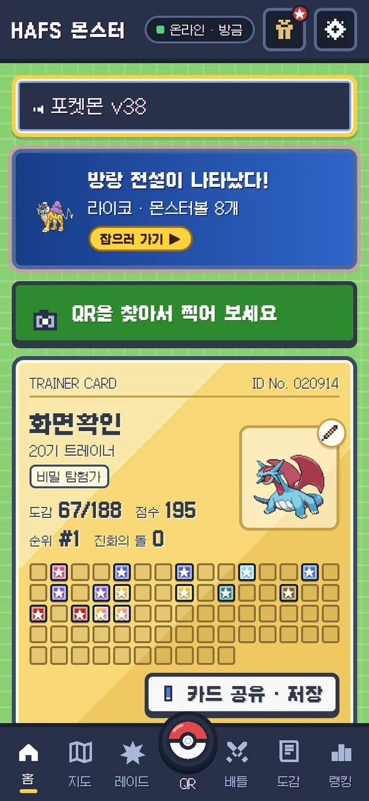

- 맨 위: 다음에 할 일 (티켓 · 퀴즈 · 방랑 전설 알림)
- 트레이너 카드: 도감 수 · 점수 · 순위 · 배지, "카드 공유 · 저장" 단추
- 그 아래: 가방 · 미니게임 · 도전과제 · 진화의 돌 룰렛
- 하단 메뉴: 홈 · 지도 · 레이드 · **QR** · 배틀 · 도감 · 랭킹
- 오른쪽 위: 이상한 소포 단추(선물 상자)와 설정 단추. 설정에서는 이름 공개 · 별명 · 우리 반 · 효과음 / 배경 음악 따로 켜고 끄기 · 운영진에게 문의하기를 합니다.

**QR 찍는 순서**

1. 가운데 **QR** 단추로 장소 QR 을 찍으면 티켓이 생깁니다.
2. 메인 부스에서 앱의 **티켓 QR** 을 보여 주면 포켓몬이 나옵니다.
3. 폰에서 바로 [잡기](#잡기) 장면이 열립니다.

처음 가 보는 장소 QR 은 알 걸음 보너스도 줍니다. 퀴즈를 맞히면 진화의 돌을 받을 때가 있습니다.

### 선생님 포켓몬과 폼

**폼**(form)은 같은 도감 번호 안의 다른 모습입니다. 선생님 포켓몬은 따로 있는 포켓몬이 아니라, 원래 포켓몬의 **선생님 폼**입니다.

| 폼 | 예 | 어디서 얻나요 | 그림 |
|---|---|---|---|
| 선생님 폼 | "물리 쌤의 피카츄" | 장소 QR · 퀴즈 · 부스 (알 · 연습 배틀 상대로는 안 나옴) | 선생님 얼굴 그림 (운영진이 올림, 없으면 원래 그림) |
| 일반 폼 | 피카츄 | 야생 · 사파리존 · 걷기 · 알 | 원래 그림 |
| 이벤트 폼 | 지우의 피카츄 (피카츄의 폼), 지우개굴닌자 (개굴닌자의 폼) | [이상한 소포](#이상한-소포와-이벤트-포켓몬)로만 | 이벤트 그림 |

- 같은 가족의 폼은 도감 번호 · 타입 · 능력치 · 기술 · 진화 방법이 같고, 이름 앞말 · 그림 · 얻는 방법만 다릅니다 (이벤트 폼은 자기 능력치와 기술을 그대로 가짐).
- 교장 · 교감 선생님 포켓몬과 학교 특별 전설은 '특별' 폼으로, 학교 도감에 들어갑니다.

### 도감

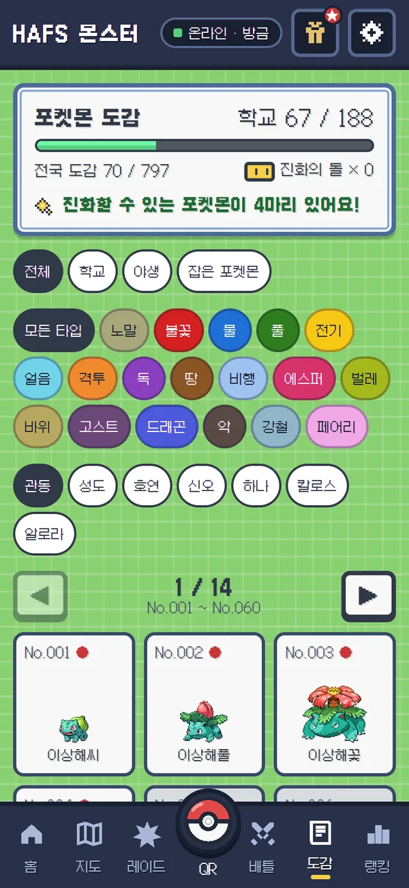

- 전국도감 번호마다 한 칸, 60칸씩 쪽을 넘깁니다 (◀ ▶ 단추).
- 고르기: 전체 / 학교 / 야생 / 잡은 포켓몬 · 18가지 타입
- 칸을 누르면 분류 · 키 · 몸무게 · 도감 설명 · 특성 · 가진 수가 나옵니다.
- 한 번호에 폼이 여럿이면 위에 **폼 바꾸기 단추**가 생깁니다. 아직 못 잡은 폼은 얻는 방법을 알려 줍니다.

**어떻게 세나요?**

- **학교**: 선생님 폼 · 특별 폼을 잡은 번호만 셉니다. 야생에서 일반 폼을 잡아도 학교 칸은 채워지지 않습니다. 운영진이 끈 선생님 폼으로 이미 잡은 것은 계속 셉니다.
- **전체**: 번호마다 한 칸, 어느 폼이든 한 번 잡으면 채워집니다 (이벤트 폼은 세지 않음). 2단계가 열려야 보입니다.
- **야생**: 일반 폼만 보입니다.
- **도감 보상**: 학교 도감 50% → 뮤츠, 100% → 지가르데와 **빛나는 부적** ([반짝이는 포켓몬](#반짝이는-포켓몬) 참고).

### 잡기

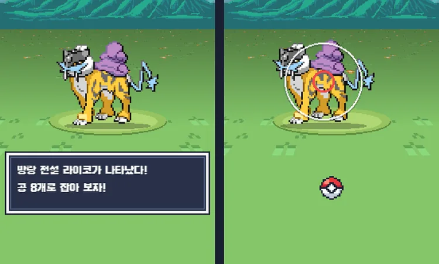

부스에서 받은 포켓몬 · 야생 포켓몬 · 방랑 전설 · 레이드 보스는 모두 폰에서 직접 잡습니다.

- 포켓몬 GO 처럼 **줄어드는 고리**에 맞춰 공을 위로 휙 던집니다.
- 공이 **고리 안**에 맞았을 때만 나이스 · 그레이트 · 엑설런트 판정이 나옵니다. 공을 휘어 던지면 커브볼 보너스.
- 레벨이 높을수록 잡기 어렵습니다. 어려울수록 안쪽 고리가 **작아지고** 색도 초록 → 노랑 → 주황 → 빨강으로 바뀝니다.
- 고리 색마다 잡힐 확률이 다릅니다 (기본: 초록 70% · 노랑 50% · 주황 33% · 빨강 18%, 판정 · 커브볼 보너스를 받아도 초록 95% · 노랑 80% · 주황 60% · 빨강 45% 를 넘지 않음). 운영자가 바꿉니다.
- 안 잡히면 포켓몬이 볼에서 **튀어나오는** 장면(번쩍임)이 나옵니다. 볼은 흔들려도 픽셀이 깨지지 않게 미리 그린 그림으로 보여 줍니다.
- 배경은 시간(낮 · 노을 · 밤)과 만난 곳(사막 · 해변 · 동굴 · 설원 · 용암 · 발전소 · 용의 굴)에 따라 바뀝니다.
- 사파리존에서 잡은 포켓몬은 바로 박스에 들어갑니다 (새로 고침해도 다시 던지기 장면이 뜨지 않음).

### PC 박스와 진화

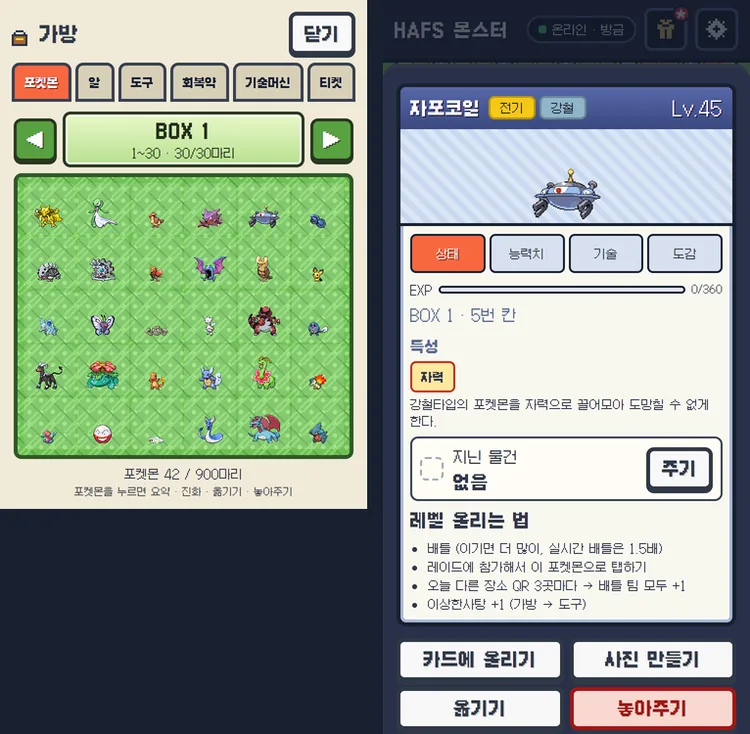

- 30칸짜리 박스 30개 = 최대 900마리. 같은 포켓몬도 한 마리씩 따로 저장됩니다.
- 포켓몬을 누르면 요약 (레벨 · 경험치 · 특성 · 지닌 물건 · 기술) · 진화 · 옮기기 · 놓아주기 · 사진 만들기

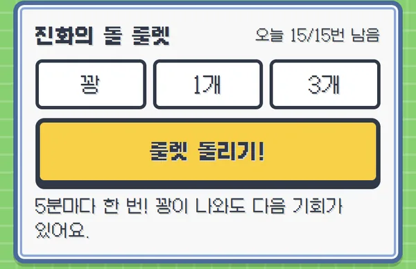

- 포켓몬은 레벨이 오르면 진화합니다.
- **여러 갈래로 진화하는 포켓몬**(이브이 · 슈륙챙이 · 랄토스 등 12가족)은 고를 수 없습니다. 서버가 **모든 갈래 중에서** 정합니다 — 기본은 모두 같은 확률이고, 운영자가 [성장 · 보상 → 진화 갈래]에서 확률을 바꿀 수 있습니다 (0 = 안 나옴).
  - 갈래 중 가장 낮은 진화 레벨이 되면 진화의 돌 없이 진화합니다 (이브이는 Lv.25 에 8갈래 중 하나, 돌로 진화하는 샤미드 · 쥬피썬더도 나옴). 그 전에는 진화의 돌로 일찍 진화할 수 있습니다.
  - 갈래가 모두 돌 진화인 냄새꼬는 지금처럼 진화의 돌이 있어야 합니다.
  - 전설 갈래 (코스모움 → 솔가레오 / 루나아라) 는 이미 가진 모습을 빼고 정해집니다. 그래서 코스모그를 두 번 잡아 키우면 둘 다 얻을 수 있습니다.
- **진화의 돌**: 레벨이 모자란 포켓몬을 일찍 진화시키거나, 돌로 진화하는 포켓몬(라이츄 · 윈디 …)에 씁니다.
- **진화의 돌 룰렛**: 정해진 간격마다 한 번, 하루 횟수 제한이 있습니다. 결과는 서버가 정하고 확률 · 간격 · 횟수는 운영자가 바꿉니다.
- 멜탄 · 멜메탈은 게임에서 빠졌습니다.

### 알 부화

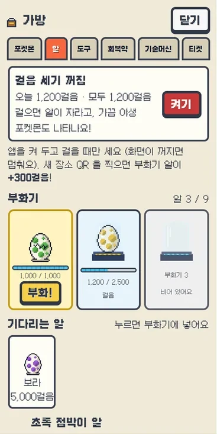

- 알 3종: 초록 1,000 · 노랑 2,500 · 보라 5,000걸음. 부화기 3칸에 넣은 알만 걸음이 쌓입니다.
- 웹앱은 폰의 걸음 수를 읽을 수 없어서, **앱이 열려 있고 화면이 켜져 있는 동안만** 움직임 센서로 걸음을 셉니다 (서버가 1분 200 · 하루 3만 걸음으로 자름).
- 알 주머니를 보는 동안은 화면이 꺼지지 않게 잡아 둡니다 (지원하는 폰만).
- 알에서는 야생 포켓몬이 태어나고, 보라 알은 가끔 전설이 나옵니다.
- **울트라비스트**(텅비드 · 매시붕 …)는 알에서 절대 나오지 않습니다. 사파리존의 울트라 스페이스에서만 만납니다.

### 사파리존

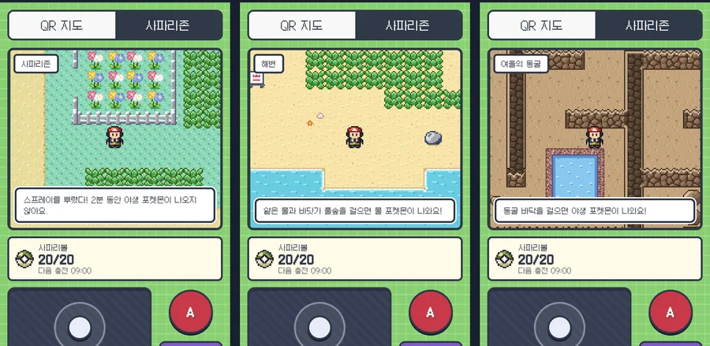

지도 탭 → 사파리존 ([2단계](#축제는-이렇게-흘러가요-해금-단계)에서 열림). 도트 지도를 걸어 다니며 야생 포켓몬을 만나고 사파리볼로 잡습니다.

**조작**

- **조이스틱**을 끌어서 걷고, **A 단추** 하나로 말 걸기 · 조사하기 (컴퓨터는 방향키 · WASD)
- **스프레이**를 뿌리면 2분 동안 야생 포켓몬이 나오지 않습니다.
- 사파리볼은 하루 20개(기본)이고, 다 쓰면 30분마다 다시 채워집니다 (기본값, 운영자가 바꿈).
- 입구에서 멀어질수록 포켓몬 레벨이 높아집니다 (Lv.5 ~ 50).

**구역마다 다른 포켓몬**

| 구역 | 가는 길 | 나오는 포켓몬 |
|---|---|---|
| 초원 | 입구 | 노말 · 벌레 · 풀 · 비행 · 전기 · 페어리 등 |
| 연못 가 | 초원 안 물가 | 물 타입이 자주 |
| 해변 · 해변 바닷길 | 바닷가 → 더 긴 바닷길 (모래톱을 밟으면 바닷길이 드러남 → 꽃의 섬) | 물 · 얼음 |
| 동굴 | 여러 층 미로 (막다른 길 · 큰 바위 · 떨어지는 구멍 · 사다리) | 바위 · 땅 · 고스트 · 독 · 강철 등 |
| 사막 | 서쪽 끝 모래길 (늘 모래바람) | 땅 · 바위 (+ 선인왕 · 마라카치 · 데스마스 · 목도리키텔) |
| 설원 | 맨 위 길 (얼어붙은 연못은 미끄러짐 · 바위에 부딪칠 때까지 미끄러지는 얼음 미끄럼 길 퍼즐) | 얼음 · 페어리 |
| 용암 지대 | 왼쪽 아래 길 (용암 호수에 박자 맞춰 가라앉는 돌 다리) | 불꽃 · 강철 |
| 발전소 1층 · 2층 · 3층 | 왼쪽 위 건물 (초록 · 파랑 스위치를 밟으면 같은 색 문이 내려가고 다른 색 문이 올라가는 퍼즐) | 전기 · 고스트 |
| 울트라 스페이스 | 워프홀 | 울트라비스트만 |
| 용의 굴 지하 1층 · 2층 | 해변 · 사막 · 설원 · 용암 지대 네 곳을 다녀오면 호수 다리 아래 섬에 계단이 생김 (지하 2층은 큰 미로) | 드래곤 + 미뇽 · 메탕 같은 600족 계열 |

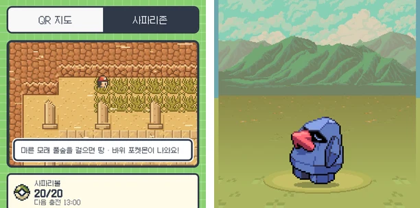

- 사막에 들어서면 "모래바람이 거세게 분다!" 글이 뜨고 지도 위에 모래바람이 붑니다. 휴대폰의 '움직임 줄이기' 설정이 켜져 있으면 움직이지 않는 옅은 모래빛만 보입니다.

### 전설 포켓몬 만나는 법

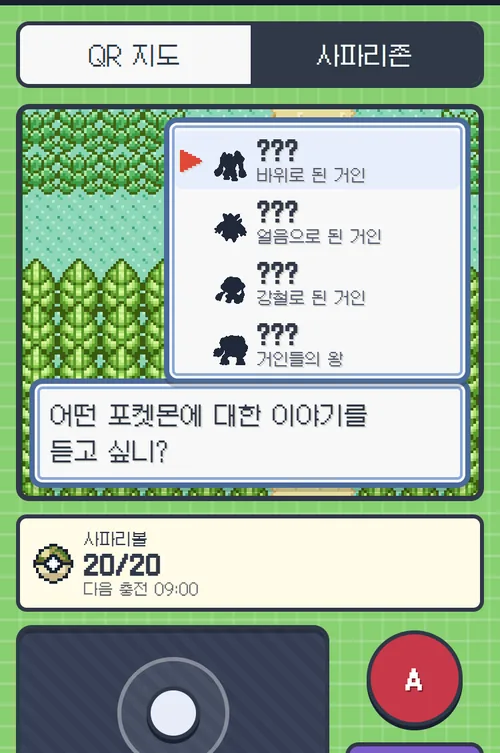

사파리 입구의 **사육사**에게 말을 걸면 아직 못 만난 전설 포켓몬이 어디에 있고, 어떤 조건을 채워야 깨어나는지 알려 줍니다.

- **사파리존의 특별한 곳** (0054: 한곳에 몰리지 않게 나누고, 가는 길을 작은 던전처럼): 꿈의 섬 · 성검의 숲 · 고대 유적 지하 1 · 2층 (미로) · 해변 바닷길 · 꽃의 섬 · 발전소 2 · 3층 (스위치 퍼즐) · 설원 얼음 미끄럼 길 · 용암 호수 가라앉는 돌 다리 · 하늘 언덕 · 용의 굴 깊은 곳 · 울트라 스페이스 · 별의 제단 · 사막. 조건(예: 그 구역에서 몇 마리 잡기)을 채우면 '깨어났다' 알림이 오고, 그 자리에서 말을 걸어 잡습니다 (한 사람에 한 번, **코스모그만 두 번** — 솔가레오 · 루나아라를 모두 얻을 수 있게. 한 마리를 잡으면 사육사가 "2번 만날 수 있어요" 라고 알려 줍니다).
- **전설 퀘스트**: 퀴즈 연속 정답 · 배틀 승리 수 · 특정 타입 잡기 같은 조건을 채우면 전설을 받거나 사파리존에서 만납니다 (예: 레지 셋 → 레지기가스).
- **방랑 전설**: 라이코 · 앤테이 · 스이쿤이 한 시간마다 다른 장소 QR 에 숨어 있습니다. 지도에 소문이 뜹니다.
- **시간대 레이드 전설**: 아침 · 점심 · 저녁 · 야자 시간마다 TV 화면이 정해진 전설 레이드를 엽니다.

**전설과 먼저 배틀** (0055): 사파리존 · 방랑 전설은 잡기 전에 내 배틀 팀으로 그 전설을 이겨야 합니다.

- 전설은 내 팀에서 가장 높은 레벨 + 8 (Lv.55 ~ 80), 체력 1.5배 (0058, 예전 2.5배), 공격 · 방어 · 특수 능력 +2 단계로 나옵니다. 쉽게 이기지 못하도록 맞춘 값이고 운영자가 바꿉니다.
- 이기면 "○○이 지쳤다! 지금이야!" 와 함께 잡기 장면이 열리고, 잡힐 확률이 1.5배가 됩니다 (고리 색의 최대 확률은 넘지 않음).
- 지거나 도망치면 오늘 도전 1번을 쓴 것이고, 전설은 그 자리에 남아 다시 도전할 수 있습니다. 배틀 중에 나가면 다시 말을 걸 때 이어집니다.

전설을 받으면 **전체 화면 연출**(검은 실루엣 → 빛나며 등장 + 짧은 팡파르)과 받은 이유가 나옵니다.

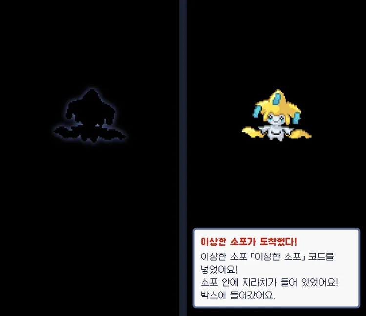

### 배틀

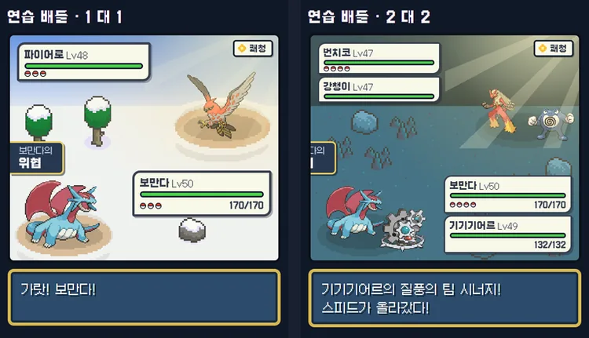

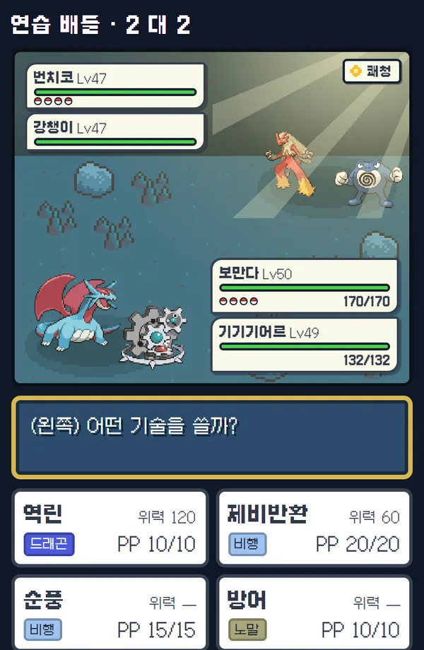

**누구와 싸우나요?**

- 연습 배틀(컴퓨터) · 친구 배틀 QR 로 친구 팀과 · 홈의 "배틀 신청!" 으로 실시간 대전
- 1 대 1, 2 대 2 모두 **배틀 팀 1 ~ 6마리** (2 대 2 는 2마리 이상).
- 컴퓨터는 내 팀과 같은 마릿수로 나옵니다. 친구와 싸우면 두 사람 중 **적은 쪽 마릿수**에 맞춰 팀 앞에서부터 나갑니다.

**배틀 규칙**

- 3세대 느낌의 화면. 기술 칸에 위력 · 타입 · PP, 효과가 없는 기술은 미리 표시
- 기술 **397개** (물수리검처럼 여러 번 때리는 기술은 한 번씩 따로 보임)
- **특성**(예: 위협) 113개가 실제로 작동
- **날씨**(쾌청 · 비 · 모래바람 · 싸라기눈)와 **필드**는 운영자가 정한 시간표나 날씨 기술로 바뀌고, 배틀 배경도 그에 맞게 바뀝니다.
- 같은 계열 포켓몬이 팀에 2마리 이상이면 팀 시너지 (능력 +1)

**보상**

- 하루에 보상을 받는 승리 수 제한이 없습니다 (운영자 설정 999 = 제한 없음).
- 같은 친구를 이긴 보상은 하루 한 번만 받습니다.

### 포켓몬 교환

친구와 **얼굴을 보고** 포켓몬을 한 마리씩 바꿉니다 (0056). 두 사람 모두 인터넷이 연결돼 있어야 합니다.

1. 한 사람이 배틀 탭(또는 가방)의 **교환** → "내 교환 QR 보여주기", 다른 사람이 그 QR 을 찍고 **포켓몬 교환하기** 를 누릅니다. 두 폰에 교환방이 열립니다.
2. 각자 보낼 포켓몬을 한 마리 고릅니다. 상대 포켓몬의 레벨 · 타입 · 특성 · 기술 · 지닌 물건이 보입니다.
3. 두 사람이 모두 **교환하기** 를 누르면 서버가 한 번에 바꿉니다. 한쪽이 포켓몬을 바꾸면 두 사람 모두 다시 눌러야 하고, 언제든 **교환 그만두기** 를 누를 수 있습니다. 3분 동안 아무것도 안 하면 방이 닫힙니다.

- **바꿀 수 있는 포켓몬**: 일반 폼만. 반짝이 · 선생님 · 전설 · 환상 · 이벤트 · 특별 · 울트라비스트, 배틀 팀과 트레이너 카드에 올린 포켓몬은 바꿀 수 없습니다 (회색 칸을 누르면 이유가 나옴). 알도 안 됩니다.
- 하루 **5번** (운영자 설정). 지닌 물건은 보낸 사람 가방으로 돌아갑니다.
- **도감**: 보낸 포켓몬도 내 도감에는 남습니다. 내가 보냈던 바로 그 포켓몬을 돌려받거나, 24시간 안에 같은 친구와 같은 계열을 주고받으면 도감 칸이 새로 채워지지 않습니다.
- **교환 진화**: 윤겔라 · 근육몬 · 데구리 · 고우스트 · 암트르 · 토쇠골은 받자마자 진화합니다.

### 레이드

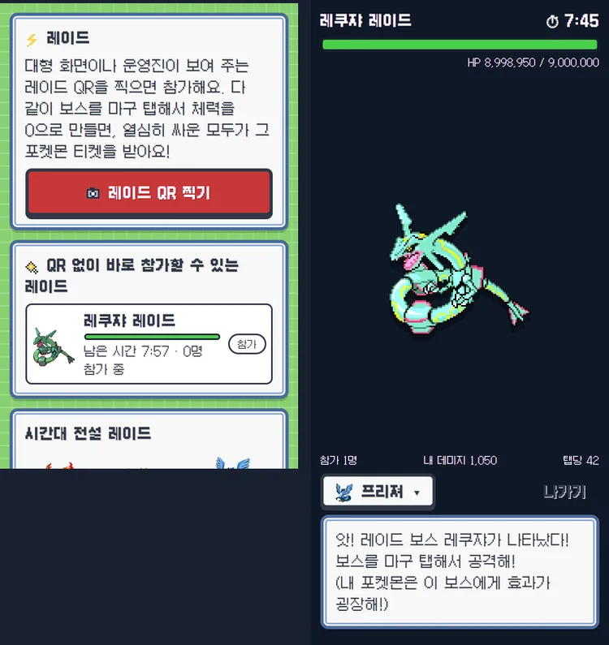

- TV 대형 화면이나 운영진이 연 레이드 QR(또는 "QR 없이 참가")로 들어가 다 함께 보스를 탭해서 쓰러뜨립니다.
- 내 포켓몬과 보스의 타입 상성이 데미지에 들어갑니다 (서버가 1초에 8번까지만 인정).
- 레이드 화면을 나갔다가 다시 들어가도 그대로 이어집니다.
- 이기면 보상 티켓을 받거나 앱에서 바로 잡습니다.
- **이로치 레이드**(✦ 표시)는 보스가 반짝이는 모습이고, 이기면 반드시 반짝이는 포켓몬을 받습니다.

### 이상한 소포와 이벤트 포켓몬

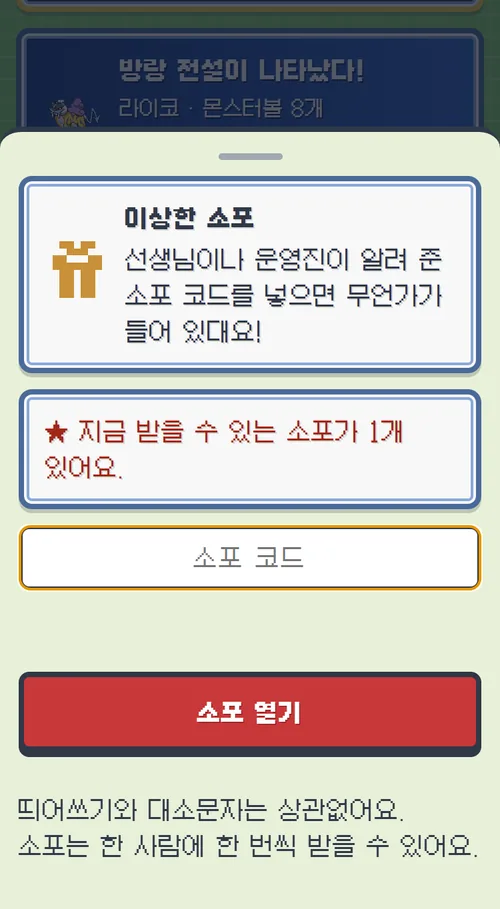

- 설정 단추 왼쪽의 선물 상자 = **이상한 소포**. 운영진이 알려 준 코드를 넣으면 포켓몬이나 물건이 들어 있습니다.
- 환상 포켓몬과 이벤트 포켓몬은 소포로만 받습니다.
- 운영진이 **반짝이는 모습**으로 넣은 소포도 있습니다 (✦ 표시).
- **이벤트 포켓몬**: 지우의 피카츄(피카츄의 폼, 기술 일렉트릭볼) · 지우개굴닌자(개굴닌자의 폼, 특성 유대변화, 물수리검이 반드시 3번 맞음). 도감에서는 그 번호(피카츄 · 개굴닌자)의 폼으로 보이고, 도감 수에는 들어가지 않습니다.

### 반짝이는 포켓몬

- 새로 만나는 모든 포켓몬(야생 · 사파리 · 부스 · 레이드 · 소포 …)은 **1/512** 확률로 색이 다른 반짝이는 모습입니다. 잡기 장면부터 반짝반짝 빛납니다.
- 알은 초록 1/256 · 노랑 1/128 · 보라 1/64.
- 학교 도감을 모두 채우면 **빛나는 부적**을 받아 모든 확률이 3배가 됩니다.

### 미니게임

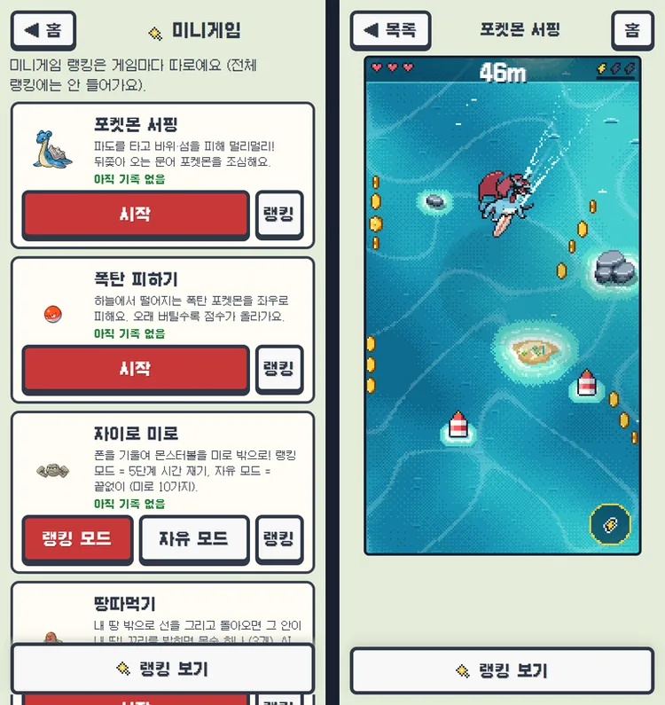

[1단계](#축제는-이렇게-흘러가요-해금-단계)(포켓몬 10종류)에서 열립니다.

- **포켓몬 서핑**: 파도 위에서 바위 · 섬 피하기. 뒤에서 대포무노가 쫓아옵니다.
- **폭탄 피하기**: 떨어지는 폭탄을 좌우로 피하기
- **자이로 미로**: 폰을 기울여 몬스터볼을 미로 밖으로
- **땅따먹기**: 선을 그려 내 땅 넓히기
- **포켓몬 등굣길**: 칸을 건너 학교까지. 멈춰 있으면 레지기가스가 쫓아옵니다.

게임마다 랭킹이 따로 있고, 말이 안 되는 점수는 서버가 거절합니다.

### 랭킹, 별명, 트레이너 카드

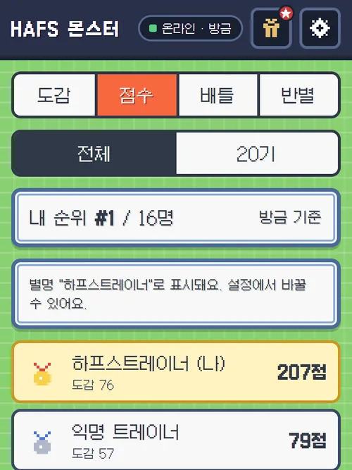

- 점수 · 도감 · 배틀 · 반별 랭킹, 전체 / 기수별
- 이름은 가운데 글자를 가려서 보여 줍니다. **별명**(2 ~ 10자, 욕설 · 사칭은 서버가 막음)을 정하면 랭킹 · TV · 배틀 상대에게 별명이 보입니다.

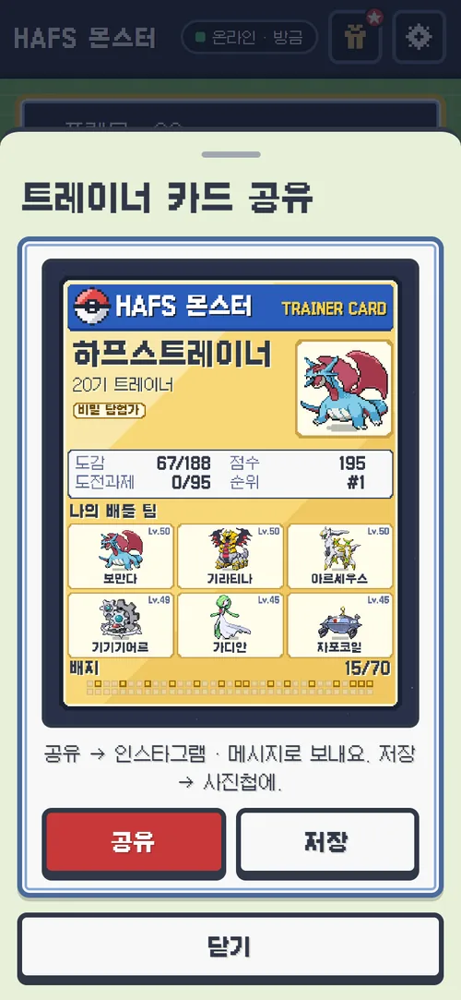

- 홈의 "카드 공유 · 저장" → 배틀 팀 · 도감 · 배지가 들어간 카드 그림을 만듭니다. 내 카드라서 **내 진짜 이름**이 들어가고, 별명이 있으면 작은 줄로 함께 나옵니다 (고유번호 · 이메일은 넣지 않음).
- 공유 창의 **이름 숨기기** 를 켜면 진짜 이름 대신 별명(없으면 '트레이너')만 들어갑니다. 인스타그램 등에 올릴 때 쓰세요. 한 번 켜면 그 폰에서 계속 켜져 있습니다.
- 폰은 공유(인스타그램 · 메시지), 컴퓨터는 PNG 파일로 저장합니다.
- 가방 → 포켓몬 → **사진 만들기**: 포켓몬 한 마리 사진을 배경을 골라 만듭니다.

### 소리와 앱 아이콘

- 배경 음악: 홈은 **4곡**을 차례로 틀고, 트레이너 배틀 · 야생 만남은 따로 곡이 있습니다. 사파리존에서 포켓몬을 만날 때 뜨는 "!" 는 야생 곡의 박자에 맞춰 나옵니다.
- 설정에서 효과음과 배경 음악을 따로 켜고 끕니다. 첫 터치 뒤에 시작하고, 화면이 꺼지면 멈춥니다.
- 홈 화면에 추가하면 파란 불꽃 볼 모양의 **앱 아이콘**이 생깁니다.

## 선생님과 운영진 안내

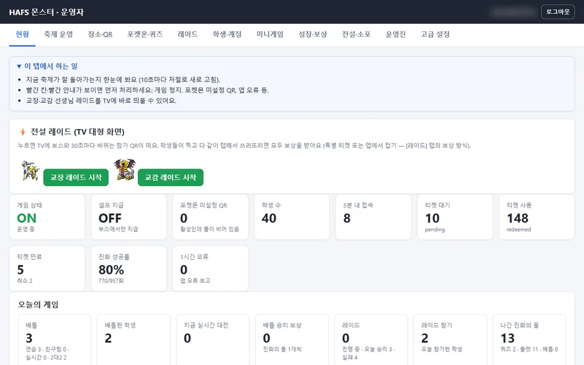

### 운영자 페이지 탭

탭마다 맨 위에 "이 탭에서 하는 일" 안내가 있습니다.

- **현황**: 게임 상태 · 접속 · 티켓 · 진화 성공률 · 오늘의 게임 숫자 (10초마다 새로 고침), 교장 · 교감 선생님 레이드 바로 시작
- **축제 운영**: 시작 · 마감 시각, 공지, **해금 단계** 카드, 사파리존 열기, **잡기 확률 (원 색깔별)** (고리 색마다 기본 · 최대 확률, 바꾸면 바로 미리보기 표가 바뀜)
- **장소 · QR**: 지도 핀 · QR 인쇄
- **포켓몬 · 퀴즈**: 선생님 포켓몬 관리 ([아래](#선생님-포켓몬-관리-포켓몬-탭)), 퀴즈
- **레이드**: 레이드 열기 · 보상 방식
- **학생 · 계정**: 비밀번호 초기화 요청 · 문의함 · 물건 · 알 주기 · 별명 지우기
- **미니게임**: 게임 켜고 끄기, 기록 관리
- **성장 · 보상**: 배틀 시간표(날씨 · 필드), 알 걸음, 반짝이 확률, 배틀 보상, **포켓몬 교환** (켜고 끄기 · 하루 횟수 · 방 닫히는 시간 · 최근 교환 목록), **진화 갈래** (갈래 가족마다 진화 전 ▶ 갈래 그림 · 조건 · 숫자 칸 · 지금 확률 %, 숫자가 클수록 잘 나옴 · 0 = 안 나옴)
- **전설 · 소포**: 소포 코드 만들기, **전설 배틀 강하기** (켜고 끄기 · 레벨 · 체력 배수 · 능력 단계 · 이긴 뒤 잡기 배수, 'AI 끼리 10판 시험' 단추로 얼마나 어려운지 확인)
- **운영진**: 운영진 아이디 만들기 · 구글 계정 초대
- **고급 설정**: 모든 설정에 무엇인지 · 단위 · 보통 값을 알려 주는 한 줄 설명

### 해금 단계와 사파리존 잠금

[축제 운영] 탭의 **해금 단계** 카드에서 합니다.

- 몇 명이 2단계에 닿았는지 봅니다.
- 1단계 숫자(미니게임, 기본 10종류)와 2단계 % (기본 30%)를 바꿉니다.
- **모두에게 열기**: 켜면 모은 수와 상관없이 모든 학생에게 2단계가 열립니다. 다시 끄면 아직 조건을 못 채운 학생은 다시 잠깁니다.
- **사파리존 열기**: 끄면 2단계가 열린 학생도 사파리존에 못 들어갑니다 (학생 앱에 "아직 닫혀 있어요"). 이미 시작한 잡기는 끝낼 수 있습니다.

### 선생님 포켓몬 관리 (포켓몬 탭)

- 포켓몬은 **가족(진화 계열)별**로 보입니다. **선생님 찾기** 보기에서는 선생님 → 과목 → 포켓몬 표로 찾습니다.
- **선생님 폼 만들기**: 가족 · 선생님 이름 · 과목을 고르면 "○○ 쌤의 △△" 폼이 생깁니다. 이브이처럼 갈래로 진화하는 가족도 됩니다.
- **다른 포켓몬으로 옮기기**: 선생님을 다른 가족으로 옮기면 퀴즈 · 장소 QR 보상도 새 폼으로 옮겨지고, 원래 폼은 꺼집니다.
- **이름 바꾸기 · 끄기**: 끈 폼은 QR · 퀴즈에 나오지 않고 학교 도감 칸에서도 빠집니다. 학생이 이미 잡은 것은 그대로입니다.
- **선생님 얼굴 그림 올리기**: 그 선생님 폼에만 쓰입니다. **그림 내려받기**로 보통 그림과 반짝이 그림을 PNG 로 저장할 수 있습니다.

### 레이드와 이상한 소포 만들기

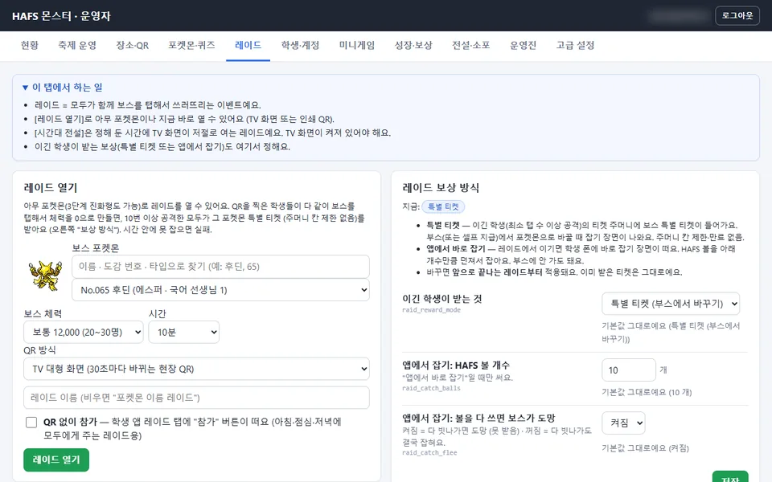

- **레이드**: 보스를 이름 · 도감 번호 · 타입으로 찾고, 체력 · 시간 · TV 또는 인쇄 QR 을 골라 엽니다. **✦ 이로치 레이드** 체크를 켜면 반짝이는 보스가 나옵니다.
- **이상한 소포**: 포켓몬(이벤트 폼 포함) 또는 물건을 넣고, 기간과 인원 제한을 정해 코드를 만듭니다. 물건은 이름으로 찾아 고릅니다. **✦ 반짝이는 (이로치) 포켓몬** 체크를 켜면 반짝이는 모습으로 들어갑니다.

### 부스 화면과 TV 대형 화면


### 축제 당일 운영 체크리스트

**전날까지**

- `web/js/config.js` 가 실전 값인지 (`DEV_LOGIN: false`, 실전 서버 주소) 확인합니다. 테스트 서버용 시험 계정(`@test.local` 운영진 · 0229xx · 0205xx ~ 0209xx 번호)은 실전 서버에 만들지 않습니다.
- 배틀 시간표 · 시간대 레이드를 실제 시간으로, 축제 시작 · 마감 시각을 맞춥니다.
- 실전 서버가 공유 CPU 가 아닌 크기(Small 이상)인지, 그 서버에서 `node tests/festival_load.mjs` 부하 시험을 돌려 봤는지 확인합니다 (테스트 서버는 작아서 축제 규모를 버티지 못함).
- `web/sw.js` 의 `VERSION` 을 올려 배포했는지 확인합니다. 예전 버전이 저장된 폰은 홈에 **⬆ 새 버전 적용하기** 단추가 뜹니다 (티켓 QR 을 띄운 동안에는 바꾸지 않음).

**문제가 생기면 끄는 스위치** (모두 운영자 페이지에서, 바로 적용)

| 상황 | 할 일 |
|---|---|
| 처음에는 QR 찍기에 집중하게 하고 싶다 | 축제 운영 → **사파리존 열기** 끄기 |
| 다 같이 사파리존을 열고 싶다 | 축제 운영 → 해금 단계 → **모두에게 열기** |
| 야생 포켓몬이 너무 많이 / 적게 나온다 | 고급 설정 → `wild_chance` (보통 0.4) |
| 미니게임에 사람이 몰려 서버가 느리다 | 미니게임 탭 → 게임 끄기 |
| 교환에서 문제가 생겼다 | 성장 · 보상 → 포켓몬 교환 → 끄기 (`trade_open`) |
| 전설이 너무 어렵다 / 쉽다 | 전설 · 소포 → 전설 배틀 강하기, 또는 축제 운영 → 잡기 확률 |

**지원 데스크 (학생이 찾아왔을 때)**

- 비밀번호를 잊었다 → 학생 · 계정 탭의 **비밀번호 초기화 요청** 에서 처리
- 포켓몬이 안 들어왔다 → 찍은 QR 은 폰에 먼저 저장됐다가 인터넷이 돌아오면 보내집니다. 홈의 "보낼 티켓" 숫자를 확인하고 와이파이를 켜게 합니다.
- 이상한 별명 → 학생 · 계정 탭에서 **별명 지우기**
- **배터리**: 알 걸음은 화면이 켜져 있어야 세므로 배터리가 빨리 닳습니다. 화면 밝기를 낮추고, 보조 배터리를 챙기라고 안내하세요.

### 축제가 끝나면

1. 운영자 페이지에서 최종 랭킹을 내려받습니다.
2. 2주 뒤 `supabase/cleanup_after_festival.sql` 로 학생 개인정보와 게임 기록을 지웁니다 (되돌릴 수 없음).

### 계획 중: 선생님 포켓몬 실물 카드

> 아직 만들지 않았습니다. 계획만 있습니다.

- 부스에서 학생의 티켓 QR 을 찍으면, 그 학생이 받을 수 있는 선생님 포켓몬 카드 목록이 나옵니다.
- 카드를 건네면 '지급' 기록이 남고 남은 수량이 줄어듭니다.
- 카드 뒷면의 QR 은 도감의 그 포켓몬 쪽을 열기만 합니다 (포켓몬을 주지 않음).

## 개발자 안내

게임 엔진 없이 브라우저 기본 기능 + Supabase 로 직접 만든 구조입니다. 빌드 단계가 없습니다.

### 용어 한 줄 설명

- **PWA**: 홈 화면에 설치해서 앱처럼 쓰는 웹사이트.
- **서비스워커**(`web/sw.js`): 앱 파일을 폰에 저장해 두는 스크립트. 그래서 인터넷이 없어도 화면이 열린다.
- **Supabase**: 데이터베이스(Postgres) + 로그인 + 파일 저장소를 한 번에 주는 서비스.
- **RPC**: 앱이 서버의 데이터베이스 함수를 부르는 것. 게임 규칙은 모두 이 함수 안에 있다.
- **RLS**(행 단위 보안): 데이터베이스가 "이 줄은 이 사람만 볼 수 있음"을 직접 지키는 규칙.
- **마이그레이션**: 데이터베이스 구조를 바꾸는 SQL 파일. 번호 순서대로 한 번씩 실행한다.
- **시드(seed)**: 포켓몬 · 기술 같은 기본 자료를 넣는 SQL 파일.

### 구조

| 부분 | 어떻게 만들었나 |
|---|---|
| 앱 (프런트엔드) | 빌드 없는 순수 ES 모듈 (`web/js/*.js`, `<script type="module">`). 번들러 · 프레임워크 없음. `web/` 폴더를 그대로 정적 호스팅에 올리면 끝 |
| PWA · 오프라인 | `web/sw.js`. 설치 때 첫 화면에 필요한 파일만 받고(CORE), 나머지(QR 카메라 · 지도 · 배틀 · 미니게임 · 사파리)는 뒤에서 받음(EXTRA). 캐시 3개: 앱 버전 캐시(`VERSION`, 배포마다 올림) · 운영자가 올린 포켓몬 그림 · 배경 음악(처음 틀 때 받고, 버전을 올려도 다시 안 받음). 티켓 QR 이 화면에 떠 있을 때는 새 버전으로 바꾸지 않음 |
| 서버 | Supabase (Postgres + Auth + Storage). 앱은 "이 기술을 골랐다", "이 QR 을 찍었다" 만 보내고 결과(포획 · 진화 · 배틀 데미지 · 룰렛 · 알 부화 · 반짝이 · 해금)는 서버 함수가 정함. 함수는 `SECURITY DEFINER` + `search_path = ''`, 표는 RLS 로 막고, 함수를 만드는 마이그레이션마다 끝에 실행 권한 블록(0006 방식)을 둬서 로그인하지 않은 사람은 부를 수 없음 |
| DB 변경 이력 | `supabase/migrations/0001 ~ 0058`. 예: 0015 배틀 엔진 · 0027 알 · 0032 실제 포켓몬 · 0033 사파리존 · 0036 PC 박스 · 0038 전설 · 소포 · 0039 특성 · 날씨 · 0042 반짝이 · 0045 배틀 팀 6마리 · 0047 기술 넓히기 · 이로치 레이드 · 0048 설원 · 용암 · 발전소 · 용의 굴 · 0049 울트라비스트 정리 · 갈래 진화 무작위 · 멜탄 빼기 · 0050 전설의 특별한 곳 · 0051 해금 단계 · 0052 폼 · 0053 배틀 보상 제한 없음 · 0054 전설 자리 나누기 · 퍼즐 지도 · 어려운 전설 조건 · 해금 30% · 0055 전설 먼저 배틀 · 고리 색별 잡기 확률 · 반짝이 소포 · 0056 포켓몬 교환 · 0057 sync 가볍게 (전설 퀘스트 확인을 바뀐 것이 있을 때만) · 0058 갈래 진화 = 모든 갈래 (운영자 확률) · 코스모그 두 번 · 전설 보스 체력 1.5배 |
| 폼 (0052) | `lines.form_kind` (normal · teacher · event · special) · `family_id` · `form_label`, `species.form_of`. 선생님 폼마다 일반 폼 복사본(계열 1000+, 종 +20000)이 야생에 나옴. 학교 칸 = `_seen_school`, 이름 = `_sp_label` / 앱 `displayName`. `_forms_build()` 가 구조를 맞춤 |
| 해금 (0051) | `_unlock_progress` · `profiles.unlocked_at`, 설정 `minigame_unlock` · `unlock_safari_pct` · `unlock_all`, sync 의 `unlock` |
| 화면 그리기 | 픽셀 아트 = `<canvas>` + `imageSmoothingEnabled = false` / CSS `image-rendering: pixelated`. 글꼴은 도트 글꼴 Galmuri11 |
| Phaser | 잡기 장면(`catch.js`)과 미니게임 일부(`surf.js` · `land.js` · `cross.js`)만 Phaser 를 씀. 그 화면을 처음 열 때 불러옴. 나머지는 직접 만든 캔버스 / DOM |
| 스프라이트 | 포켓몬 그림을 `tools/build_pokemon_sheets.py` 가 무손실 WebP 그림판(`web/sprites/pk-*.webp`)으로 묶음, 위치표 `pk-index.js`. 한 장 2048px 이하(아이폰 GPU 한계). 운영자가 올린 그림(선생님 얼굴 등)은 Storage 에 저장되고 모든 화면이 그 그림을 씀 |
| 소리 | `sfx.js` — WebAudio. 효과음은 그 자리에서 만들고, 배경 음악은 0.6초 겹쳐 바꿈 |
| 배틀 엔진 | 서버 SQL. 3세대 데미지 공식 + 자속 · 상성 · 급소 · 난수, 18타입 상성, 능력 랭크, 상태 이상, PP, 교체, 특성 113개, 날씨 · 필드, 기술 397개, 팀 1 ~ 6마리 |
| 사파리존 | `safari.js` + `safari-maps.js` (타일 지도) · `safari-caves.js` (`tools/gen_safari_caves.py` 가 만드는 동굴 미로). 풀숲 걸음은 서버(`safari_encounter`)가 속도를 확인하고 만남 · 레벨을 정함 |
| QR | 찍기 = `scanner.js` (카메라 + jsQR). 찍은 QR 은 IndexedDB(`db.js`)에 먼저 저장 → 인터넷이 돌아오면 서버로. 보여주기 = `qrcode.js` |
| 공유 | `share.js` — 트레이너 카드 · 포켓몬 사진을 캔버스로 그려 `navigator.share`(폰) 또는 PNG 저장(컴퓨터) |

### 폴더

```
web/            정적 사이트 (index = 학생 앱, admin · booth · screen = 운영 화면, s/ = 장소 QR 주소, sw.js)
  js/           ES 모듈 — app · battle · catch · safari · raid · eggs · legends · bag · dex · share · sfx …
  js/games/     미니게임 (hub · common + 게임 하나 = 파일 하나)
  vendor/       supabase.js · phaser.min.js · jsQR.js · qrcode.js
supabase/       migrations/0001~0058 · seed_battle.sql · seed_pokemon.sql · seed.sql (데모용) · cleanup_after_festival.sql
tools/          그림판 · 타일 · 동굴 · 데이터 생성 스크립트 (Python), upload_pokemon_sprites.mjs (포켓몬 그림 올리기)
tests/          rpc_test.mjs · festival_load.mjs · raid_load.mjs
```

### 내 컴퓨터에서 실행하기

```bash
cd web
python -m http.server 8124
# 학생 http://localhost:8124/ · 부스 /booth.html · TV /screen.html · 운영자 /admin.html
```

- `web/js/config.js` 의 Supabase 주소로 붙으므로 처음엔 테스트 서버에 연결됩니다.
- 파일을 고쳤는데 옛 화면이 보이면 서비스워커 캐시 때문입니다. 개발자 도구에서 Service Worker 를 지우고 새로 고침하세요.
- 배포할 때마다 `web/sw.js` 의 `VERSION` 을 올려야 학생 폰이 새 버전을 받습니다.
- 자세한 실행 · 시험 방법은 [실행 가이드 RUN.md](RUN.md).

### 테스트

- `node tests/rpc_test.mjs` — 테스트 서버에 실제로 RPC 를 불러 서버 규칙을 확인합니다. 마지막 전체 실행 (2026-11-10, 0058 포함): **1287 passed, 0 failed**. 테스트 학생 기록을 지우고 다시 만들므로 **실전 서버에는 절대 돌리지 않습니다.** (`tests/.env` 필요, 연속 3번 넘게 돌리면 로그인 횟수 제한에 걸림)
- `tests/festival_load.mjs` — 학생 600명 규모 요청(초당 70개)을 임시 학생 24명에게 나눠 보내는 부하 시험 (끝나면 임시 학생을 지움). `tests/raid_load.mjs` — 레이드 탭 폭주 시험.
- **부하 시험 결과 주의 (2026-11-10)**: 테스트 서버는 가장 작은 공유 CPU 서버라, 하루 종일 시험을 돌린 뒤에는 초당 21개에서도 요청이 30초를 넘겼습니다 (두 시간 전에는 같은 부하가 문제없었음 → CPU 몫을 다 쓴 것). 그래서 실전 서버는 **공유 CPU 가 아닌 크기(Small 이상)** 로 만들고, 축제 전에 실전 서버에서 `festival_load.mjs` 를 한 번 돌려 확인하세요.

### 실전 서버 만들기

자세한 설정은 [RUN.md 의 실전 프로젝트 체크리스트](RUN.md#실전축제-프로젝트-만들-때-체크리스트)에 있습니다. 데이터베이스 순서는 아래가 지금 파일들과 맞습니다. 큰 파일은 **사람이 없을 때** 연달아 실행하세요.

1. Supabase 새 프로젝트(서울)를 만들고 SQL Editor 를 엽니다.
2. `0001` → `0020` 을 번호 순서대로, 바로 이어서 `seed_battle.sql` (0020 이 기술 번호를 다시 매기므로 둘 사이를 비우지 않음).
3. `0021` → `0039` 를 번호 순서대로.
4. `seed_pokemon.sql` — 포켓몬 · 기술 · 특성 자료. 0038 의 열(`ultra` · `legend_src`)과 0039 의 특성 표를 쓰므로 **0039 다음에만** 됩니다.
5. 확인: `select count(*) from public.lines where ultra;` 가 0 이면, 0038 파일 위쪽의 울트라비스트 · 전설 표시 `update` 두 줄을 한 번 더 실행합니다 (0038 이 포켓몬 자료보다 먼저 돌아서 빈 표에 적용됐기 때문).
6. `0040` → `0058` 을 번호 순서대로.
7. `seed_pokemon.sql` 을 한 번 더 — 다시 돌려도 결과가 같고, 끝에서 `_forms_build()` 를 불러 폼 구조를 맞춥니다.
8. `node tools/upload_pokemon_sprites.mjs` — 포켓몬 그림을 Storage 에 올립니다 (이벤트 폼 1321 · 1324 포함, 실전 서버 주소 · 공개 키 · 운영자 계정은 환경 변수로, 사용법은 파일 맨 위).
9. 첫 운영자: `select public.bootstrap_staff('admin1', 'admin');` → 나온 비밀번호로 운영자 페이지에 로그인, 나머지 운영진은 운영진 탭에서.
10. 운영자 페이지 → 고급 설정: `battle_daily_max` 를 999 로 (새 서버는 0015 의 값 3 으로 시작함), 야자 시간 레이드 시간표를 실제 시간으로.
11. Google 로그인 · 사이트 주소 · 요청 제한 설정, `web/js/config.js` 를 실전 값으로 (`DEV_LOGIN: false`). `seed.sql` 은 데모용이라 실전에는 쓰지 않습니다.
12. `web/sw.js` 의 `VERSION` 을 올리고 `web/` 폴더를 정적 호스팅(Cloudflare Pages, 빌드 없음)에 올린 뒤, 그 주소로 QR 을 인쇄합니다.

> 4 ~ 7번 순서는 파일 내용으로 확인한 것이고, 빈 데이터베이스에서 처음부터 끝까지 시험해 보지는 않았습니다. 실전 서버 전에 빈 Supabase 프로젝트에서 한 번 해 보세요.

## English summary

A school-festival Pokémon collecting game: an installable, offline-first web app (PWA) in a GBA-era pixel-art style. Students scan QR codes around campus to collect **teacher Pokémon** (teacher forms of real Pokémon, e.g. "Physics teacher's Pikachu"). Collecting unlocks more per student: minigames at 10 species, then the walkable Safari Zone (many zones, legendary spots), wild Pokémon from QR codes and the full Pokédex at 30% of the school dex. Students also battle (teams of 1–6, 1v1 and 2v2, 397 moves, abilities, weather), trade Pokémon face to face (both confirm, server-side atomic swap), fight legendaries before catching them, solve puzzle dungeons in the Safari Zone, join raids on the big TV screen, hatch eggs by walking and redeem gift codes. Every game rule runs in Supabase Postgres functions (migrations 0001–0058); admin, booth and TV pages run the festival. No build step: serve `web/` as static files. Status: playable on staging (latest full server-rule test run: 1287 passed, 0 failed). Unofficial, non-commercial fan project, not affiliated with Nintendo, Game Freak or The Pokémon Company.

## 다른 문서

- [팀 작업 규칙 CLAUDE.md](CLAUDE.md)
- [진행 상황 · 남은 일 PROGRESS.md](PROGRESS.md)
- [실행 · 시험 · 배포 가이드 RUN.md](RUN.md)
- [설계 문서 docs/DESIGN.md](docs/DESIGN.md)
- [라이선스 (MIT) LICENSE](LICENSE)
