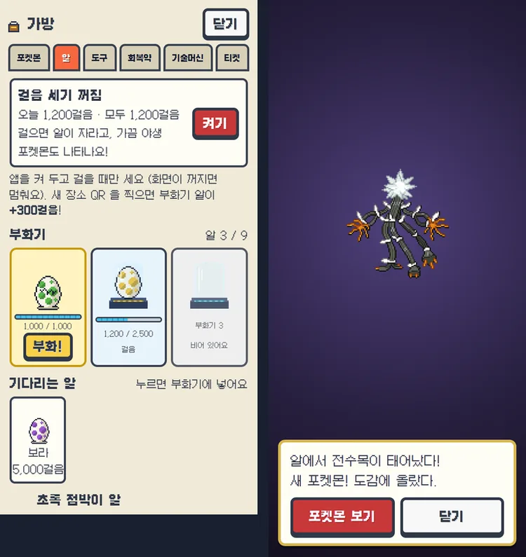
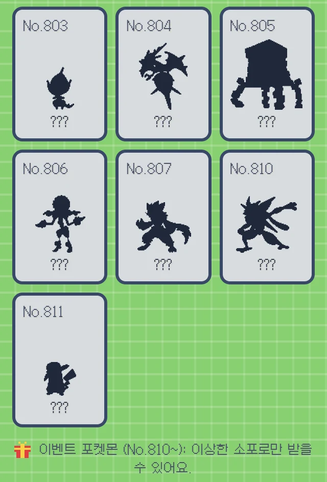

# HAFS 몬스터 (pokemon-hafs)

**학교 축제에서 폰으로 하는 포켓몬 수집 게임**입니다. 학교 곳곳에 붙은 QR 코드를 찍으며 포켓몬을 모으고, 키우고, 친구와 겨룹니다.

- **누가 쓰나요?** 축제에 온 학생·손님(폰), 메인 부스 스태프(태블릿·노트북), 운영하는 선생님·학생회(운영자 페이지)
- **무엇이 필요하나요?** 폰 브라우저만 있으면 됩니다. 앱 스토어 설치 없이 홈 화면에 추가해서 앱처럼 쓰고, 인터넷이 잠깐 끊겨도 찍은 QR 은 저장됩니다.

**학생은 이렇게 놀아요**

1. 고유번호로 로그인하고, 학교 곳곳의 **장소 QR** 을 찍어 티켓을 모읍니다.
2. **메인 부스**에서 티켓 QR 을 보여 주면 포켓몬이 나오고, 폰 화면에서 몬스터볼을 던져 잡습니다.
3. 걸어서 **알**을 부화시키고, **배틀** · **레이드** · **사파리존** · **미니게임**으로 포켓몬을 키웁니다.
4. 도감을 채우고 점수를 올려 **랭킹**에 이름(또는 별명)을 올립니다.

> 지금 상태: 테스트 서버에서 게임 전체를 할 수 있습니다 (서버 규칙 자동 시험 마지막 전체 실행 1002개 통과). 남은 일은 실제 퀴즈 내용 · 학교 구글 로그인 · 실전 서버 — [진행 상황 문서 PROGRESS.md](PROGRESS.md) 참고.
>
> 비공식 팬 게임 · 무료 학교 축제용입니다. Nintendo · Game Freak · The Pokémon Company 와 관련이 없고 승인·후원을 받지 않았습니다. 포켓몬 이름·그림의 권리는 원저작권자에게 있습니다.

## 목차

- [바로가기 (테스트 사이트)](#바로가기-테스트-사이트)
- [학생용: 게임 둘러보기](#학생용-게임-둘러보기)
- [선생님 · 운영진용](#선생님--운영진용)
- [개발자용](#개발자용)
  - [용어 한 줄 설명](#용어-한-줄-설명)
  - [엔진 · 구조](#엔진--구조)
  - [폴더 구조](#폴더-구조)
  - [내 컴퓨터에서 실행하기](#내-컴퓨터에서-실행하기)
  - [실전 서버 만들기](#실전-서버-만들기)
  - [테스트](#테스트)
- [English summary](#english-summary)
- [다른 문서](#다른-문서)

## 바로가기 (테스트 사이트)

| 화면 | 주소 | 누가 쓰나요 |
|---|---|---|
| 학생 앱 | [pokemon-hafs.pages.dev](https://pokemon-hafs.pages.dev) | 학생 · 손님 (폰) |
| 운영자 페이지 | [pokemon-hafs.pages.dev/admin](https://pokemon-hafs.pages.dev/admin) | 운영자 (운영진 탭에서 다른 운영자 초대) |
| 부스 화면 | [pokemon-hafs.pages.dev/booth](https://pokemon-hafs.pages.dev/booth) | 메인 부스 스태프 (태블릿 · 노트북) |
| TV 대형 화면 | [pokemon-hafs.pages.dev/screen](https://pokemon-hafs.pages.dev/screen) | 부스 TV (레이드 참가 QR · 랭킹 · 실시간 소식) |

운영자 · 부스 화면은 운영자가 만들어 준 운영진 아이디(또는 초대한 구글 계정)로 로그인해야 들어갈 수 있습니다.

## 학생용: 게임 둘러보기

아래 화면은 모두 테스트 서버에서 임시 계정으로 실제로 찍은 것입니다 (폰 375px 화면).

### 홈


- 맨 위: 다음에 할 일 (티켓 · 퀴즈 · 방랑 전설 알림)
- 트레이너 카드: 도감 수 · 점수 · 순위 · 배지, "카드 공유 · 저장" 단추
- 그 아래: 가방 · 미니게임 · 도전과제 · 진화의 돌 룰렛
- 하단 메뉴: 홈 · 지도 · 레이드 · **QR** · 배틀 · 도감 · 랭킹
- 오른쪽 위: 이상한 소포 단추와 설정 단추 (설정 = 이름 공개 · 별명 · 우리 반 · 효과음 / 배경 음악 따로 켜고 끄기 · 운영진에게 문의하기)

### QR 찍기와 잡기


부스에서 받은 포켓몬 · 야생 포켓몬 · 방랑 전설 · 레이드 보스는 폰에서 직접 잡습니다.

- 포켓몬 GO 처럼 **줄어드는 원**에 맞춰 공을 위로 휙 던지기
- 원 안에 맞히면 나이스 · 그레이트 · 엑설런트, 공을 휘어 던지면 커브볼
- 배경은 시간에 따라 낮 · 노을 · 밤

### 도감


- 전국도감 번호마다 한 칸, 60칸씩 쪽 넘기기
- 고르기: 학교 / 야생 / 잡은 포켓몬 · 18가지 타입 · 지방 (관동 ~ 알로라, 맨 끝 '이벤트')
- 칸을 누르면 분류 · 키 · 몸무게 · 도감 설명 · 특성 · 가진 수

### PC 박스


- 30칸짜리 박스 30개 = 최대 900마리. 같은 포켓몬도 한 마리씩 따로 저장
- 포켓몬을 누르면 요약 (레벨 · 경험치 · 특성 · 지닌 물건 · 기술) · 진화 · 옮기기 · 놓아주기 · 사진 만들기

### 진화와 진화의 돌 룰렛


- 포켓몬은 레벨이 오르면 진화합니다. 이브이처럼 여러 갈래로 진화하는 포켓몬은 모습을 고를 수 있어요.
- **진화의 돌**: 레벨이 모자란 포켓몬을 일찍 진화시키거나, 돌로 진화하는 포켓몬(라이츄 · 윈디 …)에 씁니다.
- 룰렛: 5분마다 한 번, 하루 12번 (기본값). 결과(꽝 · 1개 · 3개 · 5개)는 서버가 정하고 확률 · 간격 · 횟수는 운영자가 바꿉니다. 퀴즈를 맞혀도 가끔 돌을 받아요.

### 알 부화



- 알 3종: 초록 1,000 · 노랑 2,500 · 보라 5,000걸음. 부화기 3칸에 넣은 알만 걸음이 쌓여요.
- 웹앱은 폰의 걸음 수를 읽을 수 없어서, **앱이 열려 있고 화면이 켜져 있는 동안만** 움직임 센서로 걸음을 셉니다 (규칙적인 걸음만, 서버가 1분 200 · 하루 3만 걸음으로 자름).
- 알 주머니를 보는 동안은 화면이 꺼지지 않게 잡아 둡니다 (화면 켜 두기, 지원하는 폰만).
- 처음 가 보는 장소 QR 마다 부화기 알 +300걸음.

### 배틀 (1 대 1 · 2 대 2)


- 3세대 느낌의 배틀 화면. 기술 칸에 위력 · 타입 · PP, 효과가 없는 기술은 미리 표시
- **특성**(예: 위협)과 **날씨**(쾌청 · 비 · 모래바람 · 싸라기눈) · **필드**가 실제로 작동
- 같은 계열 포켓몬이 팀에 2마리 이상이면 팀 시너지 (능력 +1)
- 연습 배틀(컴퓨터) · 친구 배틀 QR 로 친구 팀과 · 홈의 "배틀 신청!" 으로 실시간 대전

### 레이드


- TV 대형 화면이나 운영진이 연 레이드 QR(또는 "QR 없이 참가")로 들어가 다 함께 보스를 탭해서 쓰러뜨립니다.
- 내 포켓몬과 보스의 타입 상성이 데미지에 들어가요 (서버가 1초에 8번까지만 인정).
- 이기면 보상 티켓을 받거나 앱에서 바로 잡기. 아침 · 점심 · 저녁 시간대 전설 레이드는 TV 화면이 시간표대로 엽니다.

### 사파리존 (초원 · 해변 · 동굴 · 사막)


지도 탭 → 사파리존. 도트 지도를 조이스틱으로 걸어 다니며 야생 포켓몬을 만나고 사파리볼로 잡습니다.

- 사는 곳마다 다른 포켓몬: 초원 · 연못 가 · 해변(물 · 얼음) · 동굴 · 사막(땅 · 바위) · 울트라 스페이스(울트라비스트)
- 입구에서 멀어질수록 레벨이 높아져요. 스프레이를 뿌리면 2분 동안 만남이 없어요.
- 동굴은 여러 층 미로 (막다른 길 · 큰 바위 · 떨어지는 구멍 · 사다리)


**사막 · 모래바람 지대** (새로 추가)

- 사파리존 서쪽 끝 모래길 너머. 들어서면 "모래바람이 거세게 분다!" 글이 뜨고 지도 위에 늘 모래바람이 붑니다 (움직임 줄이기 설정이면 움직이지 않는 옅은 모래빛만).
- 마른 모래 풀숲에서 땅 · 바위 타입과 선인왕 · 마라카치 · 데스마스 · 목도리키텔이 나와요 (입구 Lv.15 → 서쪽 유적 Lv.45).
- 사막에서 만난 포켓몬은 잡기 장면도 모래빛입니다.

### 사육사


사파리 입구의 사육사에게 말을 걸면 아직 못 만난 전설 포켓몬의 소문(어디서 · 어떻게 깨우는지)을 들려줍니다.

### 이상한 소포와 전설 연출


- 설정 단추 왼쪽의 선물 단추 = **이상한 소포**. 운영진이 알려 준 코드를 넣으면 소포가 열려요 (환상 포켓몬과 이벤트 포켓몬은 소포로만).
- 특별한 포켓몬을 받으면 **전체 화면 연출**(검은 실루엣 → 빛나며 등장 + 짧은 팡파르)과 받은 이유가 나옵니다. 퀘스트 전설 · 방랑 전설(라이코 · 앤테이 · 스이쿤) · 도감 보상도 같은 연출.



**이벤트 포켓몬** (새로 추가)

- **지우개굴닌자**(No.810, 특성 유대변화) · **지우의 피카츄**(No.811)는 운영진이 만든 소포 코드로만 받을 수 있어요.
- 야생 · 알 · 레이드에는 나오지 않고 도감 수에도 들어가지 않아요. 도감 맨 끝 '이벤트' 칸에서 볼 수 있어요.

### 반짝이는 포켓몬

- 새로 만나는 모든 포켓몬(야생 · 사파리 · 부스 · 레이드 · 소포 …)은 **1/512**, 알은 초록 1/256 · 노랑 1/128 · 보라 1/64 확률로 색이 다른 반짝이는 모습이에요. 잡기 장면부터 반짝반짝 빛나요.
- 학교 도감을 모두 채우면 **빛나는 부적**을 받아 모든 확률이 3배가 됩니다.

### 미니게임


- 포켓몬 서핑 · 폭탄 피하기 · 자이로 미로(폰 기울이기) · 땅따먹기 · 포켓몬 등굣길
- 게임마다 랭킹이 따로 있고, 말이 안 되는 점수는 서버가 거절합니다.

### 랭킹과 별명


- 점수 · 도감 · 배틀 · 반별 랭킹, 전체 / 기수별
- 이름은 가운데 글자를 가려서 보여 줘요. **별명**(2~10자, 욕설 · 사칭은 서버가 막음)을 정하면 랭킹 · TV · 배틀 상대에게 별명이 보입니다.

### 트레이너 카드 공유


홈의 "카드 공유 · 저장" → 배틀 팀 · 도감 · 배지가 들어간 카드 그림을 만들어, 폰은 공유(인스타그램 · 메시지), 컴퓨터는 PNG 파일로 저장합니다. 포켓몬 한 마리 사진(배경 고르기)도 만들 수 있어요.

## 선생님 · 운영진용


**운영자 페이지** (탭마다 맨 위에 "이 탭에서 하는 일" 안내가 있어요)

- 현황판: 게임 상태 · 접속 · 티켓 · 진화 성공률 · 오늘의 게임 숫자 (10초마다 새로 고침), 교장 · 교감 선생님 레이드 바로 시작
- 축제 운영 (시작 · 마감 시각, 공지) · 장소 QR (지도 핀 · 인쇄) · 포켓몬 / 퀴즈 · 레이드 열기
- 학생 / 계정 (비밀번호 초기화 요청 · 문의함 · 물건 · 알 주기) · 미니게임 · 성장 / 보상 (배틀 시간표 날씨 · 필드, 알 걸음, 반짝이 확률)
- 전설 / 소포: 소포 코드 만들기 (포켓몬 · 물건, 기간 · 인원 제한) · 운영진 아이디 · 고급 설정


**부스 화면**: 학생의 티켓 QR 을 찍거나 고유번호를 넣어 포켓몬을 줍니다.


**TV 대형 화면**: 랭킹 TOP 10 · 기수 대항전 · 방금 잡힌 포켓몬 · 레이드 참가 QR(30초마다 바뀜). 시간대 전설 레이드는 이 화면이 켜져 있을 때 시간표대로 열립니다.

**축제가 끝나면**: 운영자 페이지에서 최종 랭킹을 내려받고, 2주 뒤 `supabase/cleanup_after_festival.sql` 로 학생 개인정보와 게임 기록을 지웁니다 (되돌릴 수 없음).

## 개발자용

게임 엔진 없이 브라우저 기본 기능 + Supabase 로 직접 만든 구조입니다. 빌드 단계가 없습니다.

### 용어 한 줄 설명

- **PWA**: 홈 화면에 설치해서 앱처럼 쓰는 웹사이트.
- **서비스워커**(`web/sw.js`): 앱 파일을 폰에 저장해 두는 스크립트. 그래서 인터넷이 없어도 화면이 열린다.
- **Supabase**: 데이터베이스(Postgres) + 로그인 + 파일 저장소를 한 번에 주는 서비스.
- **RPC**: 앱이 서버의 데이터베이스 함수를 부르는 것. 게임 규칙은 모두 이 함수 안에 있다.
- **RLS**(행 단위 보안): 데이터베이스가 "이 줄은 이 사람만 볼 수 있음"을 직접 지키는 규칙.
- **마이그레이션**: 데이터베이스 구조를 바꾸는 SQL 파일. 번호 순서대로 한 번씩 실행한다.

### 엔진 · 구조

| 부분 | 어떻게 만들었나 |
|---|---|
| 앱 (프런트엔드) | 빌드 없는 순수 ES 모듈 (`web/js/*.js`, `<script type="module">`). 번들러 · 프레임워크 없음. `web/` 폴더를 그대로 정적 호스팅에 올리면 끝 |
| PWA · 오프라인 | `web/sw.js`. 설치 때 첫 화면에 필요한 파일만 받고(CORE), 나머지(QR 카메라 · 지도 · 배틀 · 미니게임 · 사파리)는 뒤에서 받음(EXTRA). 캐시 3개: 앱 버전 캐시(`VERSION`, 배포마다 올림) · 운영자가 올린 포켓몬 그림 · 배경 음악(약 9MB, 처음 틀 때 받고 버전을 올려도 다시 안 받음). 티켓 QR 이 화면에 떠 있을 때는 새 버전으로 바꾸지 않음 |
| 서버 | Supabase (Postgres + Auth + Storage). 앱은 "이 기술을 골랐다", "이 QR 을 찍었다" 만 보내고 결과(포획 · 진화 · 배틀 데미지 · 룰렛 · 알 부화 · 반짝이 확률)는 서버 함수가 정함. 함수는 `SECURITY DEFINER` + `search_path = ''`, 표는 RLS 로 막고, 마이그레이션마다 끝에 실행 권한 블록(0006 방식)을 둬서 로그인하지 않은 사람은 부를 수 없음 |
| DB 변경 이력 | `supabase/migrations/0001 ~ 0044`. 예: 0015 배틀 엔진 · 0016 2 대 2 · 0027 알 · 0028 잡기 장면 · 0032 실제 포켓몬 809종 · 0033 사파리존 · 0036 PC 박스 · 0038 전설 · 소포 · 0039 특성 · 날씨 · 0041 별명 · 0042 반짝이 · 0043 사막 · 0044 이벤트 포켓몬 |
| 화면 그리기 | 픽셀 아트 = `<canvas>` + `imageSmoothingEnabled = false` / CSS `image-rendering: pixelated`. 글꼴은 도트 글꼴 Galmuri11 |
| Phaser | 잡기 장면(`catch.js`)과 미니게임 3개(`surf.js` · `land.js` · `cross.js`)만 Phaser 를 씀. `vendor/phaser.min.js` 는 그 화면을 처음 열 때 불러옴. 폭탄 피하기 · 자이로 미로 · 사파리존 · 배틀은 직접 만든 캔버스 / DOM |
| 스프라이트 | 포켓몬 809종 + 이벤트 2종(+ 반짝이는 모습)을 `tools/build_pokemon_sheets.py` 가 무손실 WebP 그림판(`web/sprites/pk-n*.webp`, `pk-s*.webp`)으로 묶음, 위치표 `pk-index.js`. 한 장 2048px 이하(아이폰 GPU 한계). 움직이는 GIF 는 `gif.js` 가 직접 풀어서 그림. 운영자가 그림을 올리면 Storage 에 저장되고 모든 화면이 그 그림을 씀 |
| 소리 | `sfx.js` — WebAudio. 효과음은 그 자리에서 만들고, 배경 음악(메인 · 트레이너 배틀 · 야생)은 0.6초 겹쳐 바꿈. 첫 터치 뒤에 시작, 화면이 꺼지면 멈춤 |
| 배틀 엔진 | 서버 SQL (`0015` → `0016` → `0020` → `0039`). 3세대 데미지 공식(`⌊⌊⌊2·Lv/5+2⌋·위력·공격/방어⌋/50⌋` + 자속 · 상성 · 급소 · 난수), 18타입 상성, 능력 랭크, 상태 이상, 명중 · 선공, PP, 교체. 특성 113개 작동, 날씨 · 필드는 운영자 시간표나 날씨 기술로 바뀜. 1 대 1(3마리) · 2 대 2(4마리) |
| 사파리존 | `safari.js` — 타일 지도(`safari-maps.js`: 초원 · 해변 · 사막 · 깊은 연못 · 하늘 언덕 · 제단 · 울트라 스페이스), 4방향 걷기, 조이스틱 + A 단추 / 방향키 · WASD, NPC 대화. 풀숲 걸음은 서버(`safari_encounter`)가 속도를 확인하고 만남을 굴림. 동굴 미로는 `tools/gen_safari_caves.py` 가 만들어 `safari-caves.js` 에 씀 |
| QR | 찍기 = `scanner.js` (카메라 + jsQR, 처음 열 때만 불러옴). 찍은 QR 은 IndexedDB(`db.js`)에 먼저 저장 → 인터넷이 돌아오면 서버로. 보여주기(티켓 QR · 배틀 QR) = `qrcode.js` |
| 공유 | `share.js` — 트레이너 카드 · 포켓몬 사진을 캔버스로 그려서 `navigator.share`(폰) 또는 PNG 저장(컴퓨터) |

### 폴더 구조

```
web/            정적 사이트 (index = 학생 앱, admin · booth · screen = 운영 화면, s/ = 장소 QR 주소, privacy.html, sw.js)
  js/           ES 모듈 — app · battle · catch · safari · raid · eggs · legends · bag · dex · share · sfx …
  js/games/     미니게임 (hub · common + 게임 하나 = 파일 하나)
  vendor/       supabase.js · phaser.min.js · jsQR.js · qrcode.js
supabase/       migrations/0001~0044 · seed_pokemon.sql · seed_battle.sql · cleanup_after_festival.sql
tools/          그림판 · 타일 · 동굴 · 데이터 생성 스크립트 (Python), upload_pokemon_sprites.mjs (포켓몬 그림 올리기)
tests/          rpc_test.mjs · festival_load.mjs · raid_load.mjs
```

### 내 컴퓨터에서 실행하기

```bash
cd web
python -m http.server 8124
# 학생 http://localhost:8124/ · 부스 /booth.html · TV /screen.html · 운영자 /admin.html
```

- `web/js/config.js` 의 Supabase 주소로 붙으므로 처음엔 테스트 서버에 연결됩니다.
- 파일을 고쳤는데 옛 화면이 보이면 서비스워커 캐시 때문입니다 → 개발자 도구에서 Service Worker 를 지우고 새로 고침.
- 배포할 때마다 `web/sw.js` 의 `VERSION` 을 올려야 학생 폰이 새 버전을 받습니다.
- 자세한 실행 · 시험 방법은 [실행 가이드 RUN.md](RUN.md).

### 실전 서버 만들기

[RUN.md 의 실전 프로젝트 체크리스트](RUN.md#실전축제-프로젝트-만들-때-체크리스트)를 그대로 따릅니다. 큰 순서만:

1. Supabase 새 프로젝트(서울) → SQL Editor 에서 `supabase/migrations/0001 ~ 0044` 를 번호 순서대로 실행. 중간에 데이터 파일:
   - 0020 다음 `seed_battle.sql`
   - 0034 다음 `seed_pokemon.sql` (0037 · 0039 를 넣은 뒤에도 한 번씩 다시)
   - 기술 번호가 바뀌는 단계라 사람이 없을 때 연달아 실행. `seed.sql` 은 데모용이라 실전에는 쓰지 않음
2. `node tools/upload_pokemon_sprites.mjs` — 포켓몬 그림을 Storage 에 올림 (실전 서버 주소 · 공개 키 · 운영자 계정을 환경 변수로, 사용법은 파일 맨 위)
3. 첫 운영자: SQL Editor 에서 `select public.bootstrap_staff('admin1', 'admin');` → 나온 비밀번호로 운영자 페이지에 로그인, 나머지 운영진은 운영진 탭에서
4. Google 로그인 · 사이트 주소 · 요청 제한 설정, `web/js/config.js` 를 실전 값으로 (`DEV_LOGIN: false`)
5. `web/` 폴더를 정적 호스팅(Cloudflare Pages, 빌드 없음)에 올리고 그 주소로 QR 인쇄

### 테스트

- `tests/rpc_test.mjs` — 테스트 서버에 실제로 RPC 를 불러 서버 규칙을 확인 (마지막 전체 실행 1002개 통과: 권한 · 포획 · 진화 · 배틀 특성 / 날씨 · 소포 · 반짝이 · 사막 …). 테스트 학생 기록을 지우고 다시 만들므로 **실전 서버에는 절대 돌리지 않습니다.**
- `tests/festival_load.mjs` — 학생 600명 규모 요청을 섞어 70 req/s 로 보내는 부하 시험. `tests/raid_load.mjs` — 레이드 탭 폭주 시험.

## English summary

A school-festival Pokémon collecting game: an installable, offline-first web app (PWA) in a GBA-era pixel-art style. Students scan QR codes around campus for tickets, trade them at the main booth and catch the Pokémon on their phone, then level up, evolve, hatch eggs by walking, battle friends, join raids on the big TV screen, explore a walkable Safari Zone and climb the rankings. Every game rule runs in Supabase Postgres functions; admin, booth and TV pages run the festival. No build step: serve `web/` as static files. Status: playable on staging (latest full server-rule test run: 1002 passed). Unofficial, non-commercial fan project, not affiliated with Nintendo, Game Freak or The Pokémon Company.

## 다른 문서

- [팀 작업 규칙 CLAUDE.md](CLAUDE.md)
- [진행 상황 · 남은 일 PROGRESS.md](PROGRESS.md)
- [실행 · 시험 · 배포 가이드 RUN.md](RUN.md)
- [설계 문서 docs/DESIGN.md](docs/DESIGN.md)
- [라이선스 (MIT) LICENSE](LICENSE)
